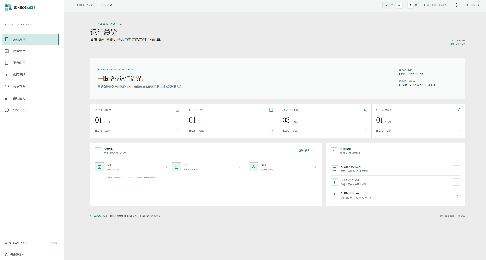

<div align="center">

# NoneBotMaker

A serverless management and AI chat service for QQ, OneBot, Telegram, Slack, LINE, WhatsApp, Discord, Satori, KOOK, WeCom, Messenger, Instagram, Viber, VK, Zulip, Rocket.Chat, DoDo, Matrix, Revolt, Mastodon, Misskey, Feishu, DingTalk, Mattermost, and WeChat Official Accounts

[Online docs](https://cfnbot.opkg.cn/en/) · [简体中文](README.md) · [AGPL-3.0](LICENSE)

</div>

## Overview

Built with TypeScript, Hono, and React, NoneBotMaker manages chat bot accounts, group/private conversation policies, and AI chat. It supports Cloudflare Workers, EdgeOne, and Alibaba Cloud ESA. Cloudflare can also use a Durable Objects WebSocket Gateway.

### Supported chat platforms

| Platform | Integration | Callback path | Notes |
| --- | --- | --- | --- |
| QQ official bot | Webhook / Cloudflare WebSocket Gateway | `/webhook/qq` | QQ Open Platform AppID and AppSecret |
| OneBot v11 | HTTP reports + HTTP API | `/webhook/onebot` | Works with NapCat, go-cqhttp, Koishi, Red, and the Mirai OneBot plugin; optional HMAC-SHA1 report signatures |
| Telegram | Bot API Webhook | `/webhook/telegram` | Callback verified with the `setWebhook` `secret_token` |
| Feishu / Lark | Event subscription v2 | `/webhook/feishu` | Plaintext or Encrypt Key events; text, image, and file replies |
| DingTalk robot | Internal robot callback | `/webhook/dingtalk` | timestamp/sign verification and sessionWebhook replies; proactive messages need RobotCode |
| WeChat Official Account | Server configuration (plaintext mode) | `/webhook/wechat` | SHA1 signature verification; customer-service text, image, voice, and video replies |
| Slack | Events API | `/webhook/slack` | Signing Secret verification with text and file uploads; channels require an @mention |
| LINE | Messaging API Webhook | `/webhook/line` | Channel Secret verification and push API text replies; groups require an @mention |
| WhatsApp Cloud API | Meta Webhook | `/webhook/whatsapp` | X-Hub-Signature-256 verification for one-to-one chats; subject to the 24-hour window |
| Mattermost | Outgoing webhook + REST API | `/webhook/mattermost` | Token verification, trigger-word messages, and file uploads |
| Discord | Gateway WebSocket (Cloudflare Durable Object) | Auto-connected, no callback URL | Requires the Message Content Intent; channels need an @mention; media supported |
| Satori | Satori WebSocket (Cloudflare Durable Object) | Auto-connected, no callback URL | Connects to multiple platforms through Koishi and other SDKs; text only |
| KOOK | Gateway WebSocket (Cloudflare Durable Object) | Auto-connected, no callback URL | Channel and direct text, images, and files; requires Cloudflare |
| WeCom | Self-built app callback (encrypted mode) | `/webhook/wecom` | Direct messages only; text and media; trusted IP required |
| Facebook Messenger | Meta Webhook | `/webhook/messenger` | Page one-to-one text and attachments |
| Instagram Messaging | Meta Webhook | `/webhook/instagram` | Professional account one-to-one text |
| Viber | Bot Webhook | `/webhook/viber` | One-to-one text with HMAC verification |
| VK | Callback API | `/webhook/vk` | Community direct and group text |
| Zulip | Outgoing webhook + REST | `/webhook/zulip` | Stream topics and direct messages; files sent as links |
| Rocket.Chat | Outgoing webhook + REST | `/webhook/rocketchat` | Channel/direct text and files |
| DoDo | Gateway WebSocket (Cloudflare Durable Object) | Auto-connected, no callback URL | Channel/direct text and images; requires Cloudflare |
| Matrix | `/sync` long polling (Cloudflare Durable Object) | Auto-connected, no callback URL | Unencrypted rooms only; text and media |
| Revolt | Bonfire WebSocket (Cloudflare Durable Object) | Auto-connected, no callback URL | Channel/direct text and attachments |
| Mastodon | User streaming WebSocket (Cloudflare Durable Object) | Auto-connected, no callback URL | Mentions and direct messages; text and media |
| Misskey | Streaming API WebSocket (Cloudflare Durable Object) | Auto-connected, no callback URL | Channels, mentions, and direct messages; text and media |

See [Chat platform setup](docs/en/guide/chat-platforms.md) for credentials, callback configuration, and limitations. DingTalk callbacks do not support proactive media, and WeChat Official Accounts do not support file customer-service messages or encrypted (safe-mode) callbacks. OneBot requires both an HTTP report URL and an API base URL; Telegram requires a `secret_token`; Slack requires `chat:write` (plus `files:write` for uploads); WhatsApp is limited by the 24-hour customer-service window; Discord, Satori, KOOK, DoDo, Matrix, Revolt, Mastodon, and Misskey use Durable Object connections and are only available on Cloudflare, not EdgeOne or ESA; WeCom requires the service egress IP in its trusted IP list.

<div align="center">
  
</div>

### Compatibility

This is a TypeScript service for serverless runtimes, not a Python NoneBot, Koishi, or NapCat runtime. It connects through each platform's official Webhooks/APIs and cannot load arbitrary Python/Node plugins, drivers/adapters, or local shell/filesystem tools. Real QQ, OneBot, Telegram, Slack, LINE, WhatsApp, Discord, Satori, KOOK, WeCom, Messenger, Instagram, Viber, VK, Zulip, Rocket.Chat, DoDo, Matrix, Revolt, Mastodon, Misskey, Feishu, DingTalk, Mattermost, and WeChat Official Accounts, AI, Brave, TTS, and media capabilities require integration tests with real accounts and services.

## Quick Deployment

Choose a platform to start:

<div align="center">

[](https://deploy.workers.cloudflare.com/?url=https%3A%2F%2Fgithub.com%2FPIKACHUIM%2FNoneBotMaker)
[](https://edgeone.ai/pages/new?repository-url=https%3A%2F%2Fgithub.com%2FPIKACHUIM%2FNoneBotMaker&repository-name=NoneBotMaker&project-name=NoneBotMaker&install-command=npm%20install&build-command=npm%20run%20build%3Aedgeone&output-directory=dist)

</div>

- **Cloudflare / EdgeOne:** The buttons open the platform's repository import or deployment flow. Configure your own resources and variables as required.
- **Alibaba Cloud ESA:** [Open the ESA console](https://esa.console.aliyun.com/) and import the GitHub repository. There is no one-click deployment button for this project on ESA.
- One-click deployment does not configure QQ Open Platform, Feishu Open Platform, DingTalk Open Platform, or the WeChat Official Account console. Before going live, configure storage, `SYS_PASSWD`, and `SYS_SECRET`; initialize the database; and set the callback URL for each enabled platform (for example `https://<your-domain>/webhook/qq`).
- For Cloudflare, review the resource IDs and domains in `wrangler.jsonc` and replace them with your own. Do not use another account's resources.

See the [quick deployment guide](docs/en/guide/quick-start.md) for details.

## Features

- **Admin console:** Manage plugins, QQ/OneBot/Telegram/Slack/LINE/WhatsApp/Discord/Satori/KOOK/WeCom/Messenger/Instagram/Viber/VK/Zulip/Rocket.Chat/DoDo/Matrix/Revolt/Mastodon/Misskey/Feishu/DingTalk/Mattermost/WeChat accounts, conversation policies, AI providers, model pricing, MCP, Skills/Rules, and memory.
- **AI chat:** OpenAI-compatible APIs, multi-round tool calls, streaming, conversation context, and role cards.
- **Persona and prompts:** Per-conversation personas layered with identity policy, system rules, role cards, memory, and Skills/Rules.
- **Tools and approvals:** Web search, messaging, and media tools; MCP tools are controlled by allowlists and owner approval, and pending arguments can be edited before approval.
- **Runtime management:** Conversation modes, allowlists, budgets, context, logs, scheduled wakeups, and media assets.
- **Cost control:** Presets for common models; text models without a registered price use a default $3 input / $15 output per million tokens.
- **Multi-platform storage:** Cloudflare D1/KV/DO, EdgeOne Blob/KV, and ESA KV adapters.

## How It Works

Platform entry points pass requests to the shared Hono application. Each platform Webhook is verified with its own signature or token and normalized into the shared message contract before the account and conversation policy are resolved. The chat runtime loads permissions, context, and model settings, calls the AI API, executes permitted tools, and replies through that platform's send API. Platform-specific storage adapters provide persistence; missing bindings are reported instead of silently replaced with process-local state.

## Development and Deployment

Node.js `>=20` is required. Start the local environment and run checks:

```sh
npm ci
npm run dev
npm run typecheck
npm test
npm run build
```

Build for each platform:

```sh
npm run build:worker
npm run build:edgeone
npm run build:esa
```

`build:worker` runs a dry run only. EdgeOne and ESA use Webhook and do not support the WebSocket Gateway. The local Node entry does not create D1/KV; validate persistence-dependent features in an environment with storage bindings.

Preview locally with `npm run docs:dev`; build with `npm run docs:build`. Source files live in `docs/`; pushes to `main` trigger GitHub Actions to publish the [online documentation site](https://cfnbot.opkg.cn/en/).

## References

- [NoneBot2](https://github.com/nonebot/nonebot2), [Koishi](https://koishi.chat/), and [NapCat](https://github.com/NapNeko/NapCatQQ): Reference for events, matchers, sessions, and multi-platform adapters; this project does not run their runtimes or plugins.
- [VitePress](https://vitepress.dev/): Documentation site generator.
- [Cloudflare Workers](https://developers.cloudflare.com/workers/), [EdgeOne](https://edgeone.ai/document), and [Alibaba Cloud ESA](https://help.aliyun.com/product/58613.html): Platform runtime and storage documentation.

## License

This project is licensed under the [GNU Affero General Public License v3.0](LICENSE) (AGPL-3.0).
