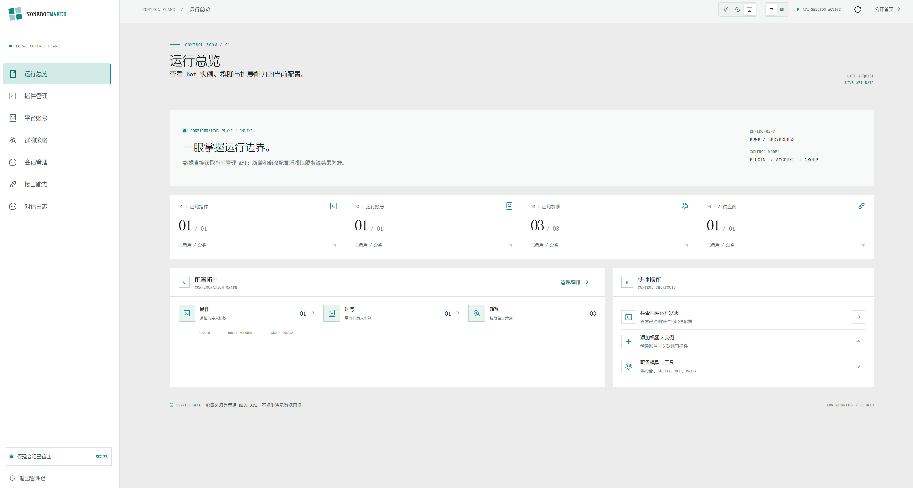

<div align="center">

# NoneBotMaker

面向 QQ、OneBot、Telegram、飞书、钉钉与微信公众号的 Serverless 管理与 AI 聊天服务

[在线文档站](https://cfnbot.opkg.cn/) · [English](README.en.md) · [AGPL-3.0](LICENSE)

</div>

## 项目简介

NoneBotMaker 使用 TypeScript、Hono 和 React，提供聊天机器人账号、群聊/私聊策略和 AI 对话管理。支持 Cloudflare Workers、EdgeOne 和阿里云 ESA；Cloudflare 还可使用 Durable Objects WebSocket Gateway。

### 支持的聊天平台

| 平台 | 接入方式 | 回调地址 | 说明 |
| --- | --- | --- | --- |
| QQ 官方机器人 | Webhook / Cloudflare WebSocket Gateway | `/webhook/qq` | 使用 QQ 开放平台 AppID 与 AppSecret |
| OneBot v11 | HTTP 上报 + HTTP API | `/webhook/onebot` | 可接 NapCat、go-cqhttp、Koishi、Red、Mirai OneBot 插件；可选 HMAC-SHA1 上报签名 |
| Telegram | Bot API Webhook | `/webhook/telegram` | 使用 `setWebhook` 的 `secret_token` 校验回调 |
| 飞书 / Lark | 事件订阅 v2 | `/webhook/feishu` | 支持明文或 Encrypt Key 加密事件；回复文本、图片与文件 |
| 钉钉机器人 | 企业内部机器人回调 | `/webhook/dingtalk` | 使用 timestamp/sign 校验，通过 sessionWebhook 回复；主动消息需 RobotCode |
| 微信公众号 | 服务器配置（明文模式） | `/webhook/wechat` | SHA1 签名校验，通过客服消息接口回复文本、图片、语音与视频 |

各平台的凭据、回调配置和限制见[聊天平台接入](docs/guide/chat-platforms.md)。钉钉回调不支持主动媒体消息，微信公众号不支持客服消息文件类型，也不支持安全模式（加密）回调。OneBot 需要同时配置 HTTP 上报地址与 API 地址；Telegram 需要设置 `secret_token`。

<div align="center">
  
</div>

### 兼容性边界

本项目是在 Serverless 环境中实现的 TypeScript 服务，不是 Python NoneBot、Koishi 或 NapCat 运行时。它通过各平台官方 Webhook/API 接入，不能直接加载任意 Python/Node 插件、driver/adapter 或本地 shell、文件系统工具。真实 QQ、OneBot、Telegram、飞书、钉钉、微信、AI、Brave、TTS 和媒体能力需要使用真实账号与服务联调。

## 快速部署

选择平台开始部署：

<div align="center">

[](https://deploy.workers.cloudflare.com/?url=https%3A%2F%2Fgithub.com%2FPIKACHUIM%2FNoneBotMaker)
[](https://edgeone.ai/pages/new?repository-url=https%3A%2F%2Fgithub.com%2FPIKACHUIM%2FNoneBotMaker&repository-name=NoneBotMaker&project-name=NoneBotMaker&install-command=npm%20install&build-command=npm%20run%20build%3Aedgeone&output-directory=dist)

</div>

- **Cloudflare / EdgeOne**：按钮会带你进入对应平台的仓库导入或部署流程。部署前按平台要求配置自己的资源和变量。
- **阿里云 ESA**：[打开 ESA 控制台](https://esa.console.aliyun.com/)后导入 GitHub 仓库；ESA 当前没有本项目可用的一键部署按钮。
- 一键部署不会代替 QQ 开放平台、飞书开放平台、钉钉开放平台或微信公众号后台的配置。上线前仍需配置存储、`SYS_PASSWD`、`SYS_SECRET`，初始化数据库，并在对应平台设置回调地址（如 `https://<你的域名>/webhook/qq`）。
- Cloudflare 首次部署请检查 `wrangler.jsonc` 中的资源 ID 和域名，替换为自己的配置；不要直接使用其他账户的资源。

详细步骤见[快速部署指南](docs/guide/quick-start.md)。

## 功能介绍

- **管理台**：管理插件、QQ/OneBot/Telegram/飞书/钉钉/微信账号、会话策略、AI 供应商、模型价格、MCP、Skills/Rules 和记忆。
- **AI 对话**：支持兼容 OpenAI 的 API、多轮工具调用、流式响应、会话上下文与角色卡。
- **人设与提示词**：每个会话可单独设置人设，和身份策略、系统规则、角色卡、记忆及 Skills/Rules 分层组装。
- **工具与审批**：提供联网搜索、消息和媒体工具；MCP 工具受 allowlist 与 owner 审批控制，待审批调用可先编辑参数再批准。
- **运行管理**：支持会话模式、白名单、预算、上下文、日志、计划唤醒和素材管理。
- **成本控制**：内置常用模型单价预置；未登记单价的文本模型按默认 $3 输入 / $15 输出每百万 token 计费。
- **多平台存储**：适配 Cloudflare D1/KV/DO、EdgeOne Blob/KV 与 ESA KV。

## 工作原理

平台入口将请求交给共享 Hono 应用。各平台 Webhook 经各自的签名/令牌校验后归一化为统一消息，再解析账号和会话策略；聊天运行时读取权限、上下文与模型配置，调用 AI API 并执行获准的工具，最后通过对应平台的发送接口回复。持久化由各平台的存储适配器负责；缺少必要 binding 时会报错，不以进程内状态替代。

## 开发部署

需要 Node.js `>=20`。本地启动和检查：

```sh
npm ci
npm run dev
npm run typecheck
npm test
npm run build
```

平台构建：

```sh
npm run build:worker
npm run build:edgeone
npm run build:esa
```

`build:worker` 只运行 dry-run。EdgeOne 与 ESA 使用 Webhook，不支持 WebSocket Gateway。本地 Node 入口不会自动创建 D1/KV；持久化功能需在配置了存储 binding 的环境验证。

本地预览文档站：`npm run docs:dev`；构建：`npm run docs:build`。源文件位于 `docs/`，推送到 `main` 后由 GitHub Actions 自动发布到[在线文档站](https://cfnbot.opkg.cn/)。

## 参考项目

- [NoneBot2](https://github.com/nonebot/nonebot2)、[Koishi](https://koishi.chat/)、[NapCat](https://github.com/NapNeko/NapCatQQ)：事件、matcher、session 与多平台适配概念的参考；本项目不运行其运行时或插件。
- [VitePress](https://vitepress.dev/)：项目文档站生成器。
- [Cloudflare Workers](https://developers.cloudflare.com/workers/)、[EdgeOne](https://edgeone.ai/document)、[阿里云 ESA](https://help.aliyun.com/product/58613.html)：平台运行与存储文档。

## 开源许可

本项目采用 [GNU Affero General Public License v3.0](LICENSE)（AGPL-3.0）。
