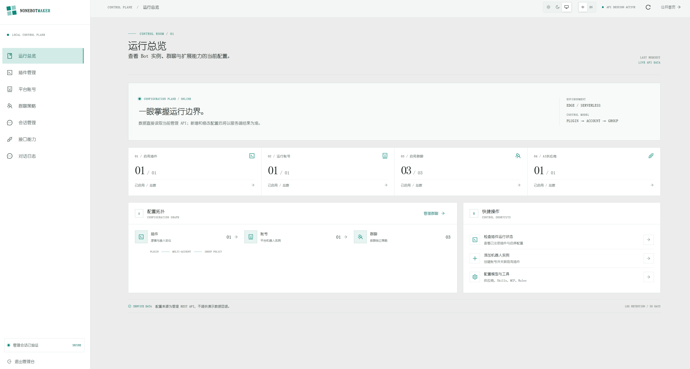

## Interface Preview

## Documentation

- [Quick deployment](/en/guide/quick-start): storage, secrets, migrations, and QQ Webhook setup.
- [Admin console guide](/en/guide/user-guide): configure AI providers, accounts, policies, tools, and memory.
- [Project requirements](/en/design/requirements): implemented capabilities and explicit boundaries.
- [System architecture](/en/design/architecture): module boundaries, message flow, persistence, and trust boundaries.
- [Local development and tests](/en/development/setup) and [platform deployment](/en/development/deployment).

> Requirements and architecture are derived from the current code, configuration, and tests; they are not a separately approved product specification. End-to-end validation with real QQ, AI, Brave, and TTS services still requires real accounts and credentials.
