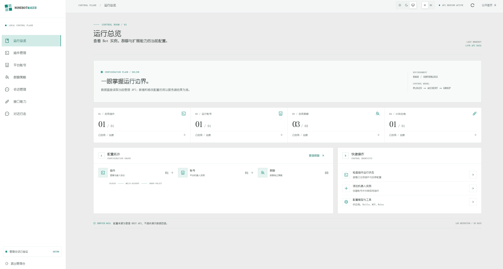

## 界面预览

## 文档导航

- [快速部署](/guide/quick-start)：准备存储资源、密钥、迁移并配置 QQ Webhook。
- [管理台使用教程](/guide/user-guide)：创建 AI 供应商、账号、会话策略并管理工具和记忆。
- [项目需求](/design/requirements)：基于当前实现整理的功能需求与限制。
- [系统设计](/design/architecture)：模块边界、消息数据流、持久化和信任边界。
- [本地开发与测试](/development/setup) 与 [多平台部署](/development/deployment)。

> 需求与架构文档依据当前代码、配置和测试整理；尚无独立产品签字确认的正式规格。真实 QQ、AI、Brave 与 TTS 外部服务仍需使用真实账号和凭据联调。
